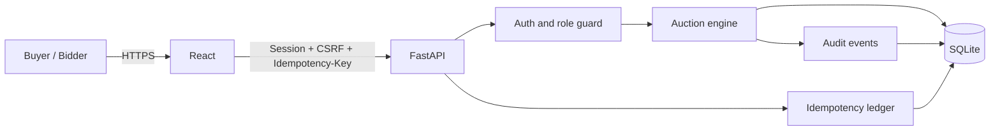
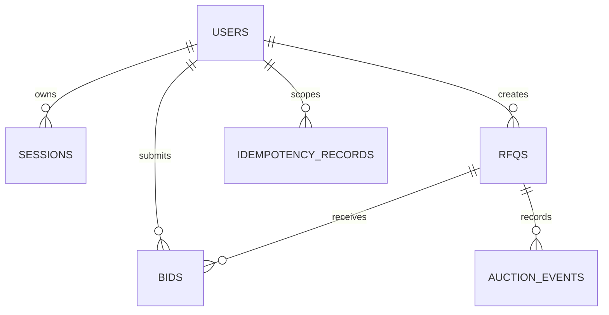

# GoComet — British Auction Control Tower

A full-stack freight procurement workspace for running transparent British auctions. Buyers can launch an RFQ, receive ranked carrier bids, track the current L1 price, and automatically extend competitive events when qualifying activity happens near closing time.

**Live application:** [go-comet-xi.vercel.app](https://go-comet-xi.vercel.app)

## Demo login

| Role | Email | Password | Access |
| --- | --- | --- | --- |
| Buyer | `buyer.demo@example.com` | `BuyerDemo!2026` | Create auctions, see full rankings, review audits |
| Bidder | `bidder.demo@example.com` | `BidderDemo!2026` | View opportunities and submit bids as Northstar Logistics |

These credentials are intentionally public. The mock login exercises server-side sessions, CSRF protection, privacy masking, and role authorization, but it must be replaced with a real identity provider before production use.

## Product highlights

- Live, scheduled, closed, and force-closed auction views
- Automatic L1 supplier ranking based on total landed bid price
- Configurable anti-sniping window and extension duration
- Hard forced-close time that extensions cannot exceed
- Supplier bid breakdowns for freight, origin, and destination charges
- Transit-time and quote-validity tracking
- Append-only auction activity timeline
- Search and status filters
- Responsive desktop and mobile interface
- Seeded demonstration auctions visible immediately after deployment
- Buyer and bidder role separation
- Idempotent RFQ creation and bid submission
- HttpOnly sessions, CSRF validation, login throttling, and secure response headers

The interface uses the visual language of the MindMesh AI/ML workspace: warm paper surfaces, charcoal navigation, lime highlights, editorial serif headings, and compact data-focused labels.

## Demo data

The hosted application includes four example freight events:

| RFQ | Lane | Status | Example data |
| --- | --- | --- | --- |
| RFQ-DEMO-1043 | Bengaluru → Chennai | Scheduled | Upcoming express-cargo event |
| RFQ-DEMO-1042 | Mumbai → Delhi | Live | Four ranked supplier bids |
| RFQ-DEMO-1039 | Pune → Hyderabad | Closed | Completed refrigerated auction |
| RFQ-DEMO-1037 | Ahmedabad → Jaipur | Force closed | Completed part-load event |

Set `SEED_DEMO_DATA=true` to insert the sample records into an empty database. Existing databases are never overwritten.

## Technology

| Layer | Technology |
| --- | --- |
| Frontend | React 19, TypeScript, Vite, responsive CSS |
| Backend | FastAPI, Pydantic |
| Database | SQLite |
| Testing | Pytest, FastAPI TestClient |
| Production | Multi-stage Docker container |
| Hosting | Vercel and Render configuration included |

## Architecture



FastAPI owns identity, authorization, auction status, totals, ranking, extension decisions, and privacy filtering. Writes use a SQLite `BEGIN IMMEDIATE` transaction so the bid, extension, audit records, and idempotency response commit together.

Read the full [architecture document](docs/architecture.md).

## Schema



The schema includes users, hashed sessions, RFQs, immutable bids, audit events, and stored idempotency responses. See the complete [schema and constraint reference](docs/schema.md).

## Design and security

The [security and application design document](docs/design.md) describes:

- Buyer and bidder authorization
- Mock session creation and revocation
- CSRF double-submit validation
- Idempotency replay and conflict behavior
- Auction transaction boundaries
- Supplier privacy and audit redaction
- Input, request-size, CORS, trusted-host, and response-header controls
- Production limitations and recommended upgrades

## Run locally

### 1. Start the FastAPI backend

```powershell
cd backend
python -m venv .venv
.venv\Scripts\Activate.ps1
pip install -r requirements.txt
$env:SEED_DEMO_DATA = "true"
uvicorn app.main:app --reload
```

The API runs at <http://127.0.0.1:8000>. Interactive documentation is available at <http://127.0.0.1:8000/docs>.

### 2. Start the React frontend

Open another terminal:

```powershell
cd frontend
npm install
npm run dev
```

Open <http://localhost:5173>. Vite proxies `/api` requests to FastAPI on port 8000.

For a separately hosted backend, provide its origin through `VITE_API_URL`.

## Configuration

| Variable | Default | Purpose |
| --- | --- | --- |
| `RFQ_DATABASE_PATH` | `backend/rfq.db` | Location of the SQLite database |
| `SEED_DEMO_DATA` | `false` | Adds demonstration auctions when the database is empty |
| `AUTH_COOKIE_SECURE` | `false` locally | Sends authentication cookies only over HTTPS when enabled |
| `ALLOWED_HOSTS` | Localhost plus deployment hosts | Comma-separated trusted Host values |
| `CORS_ALLOWED_ORIGINS` | Local Vite origins | Comma-separated browser origins |
| `PASSWORD_HASH_ITERATIONS` | `180000` | PBKDF2 work factor; lower values are used only in tests |
| `VITE_API_URL` | Same origin | Optional external backend origin used by the frontend |

## Auction rules

An auction can extend when a bid arrives inside its configured trigger window. Three trigger modes are available:

1. Any bid is received.
2. Any supplier ranking changes.
3. The L1 or lowest-priced supplier changes.

The updated close time is:

```text
min(current close + extension duration, forced close)
```

The API rejects bids outside the active interval. Every bid submission and auction extension is recorded in the activity log.

## API overview

| Method | Endpoint | Purpose |
| --- | --- | --- |
| `GET` | `/api/health` | Service health check |
| `POST` | `/api/auth/login` | Start a role-aware mock session |
| `GET` | `/api/auth/session` | Resolve the current session |
| `POST` | `/api/auth/logout` | Revoke the current session |
| `GET` | `/api/rfqs` | List and filter auctions |
| `POST` | `/api/rfqs` | Create an auction; buyer + CSRF + idempotency required |
| `GET` | `/api/rfqs/{id}` | Get auction details, bids, and events |
| `POST` | `/api/rfqs/{id}/bids` | Submit a bid; bidder + CSRF + idempotency required |

The generated OpenAPI reference is available at `/docs` whenever the backend is running.

## Deploy

### Vercel

The production project is connected to the repository's `main` branch. Every push triggers a new deployment.

`Dockerfile.vercel` builds the React application and packages it with FastAPI as a Vercel container. The frontend and API are served from the same origin.

Vercel Functions use ephemeral storage. The included SQLite database is suitable for demonstration data, but production auctions should use durable PostgreSQL storage.

### Render

The repository also includes a Render Blueprint and production Dockerfile:

[](https://render.com/deploy?repo=https://github.com/Autistic-coder/go-comet)

The free Blueprint uses ephemeral SQLite storage. For persistent data, attach a disk and set `RFQ_DATABASE_PATH=/data/rfq.db`, or migrate the schema to Render Postgres.

## Project structure

```text
backend/
  app/
    database.py       SQLite setup and demonstration records
    auth.py           Sessions, CSRF, roles, and login throttling
    main.py           FastAPI routes, middleware, and auction rules
    schemas.py        Request and response models
    security.py       Password and token cryptography
  tests/
    test_auction.py   Auction, extension, privacy, and seed tests
    test_security.py  Auth, CSRF, RBAC, idempotency, and validation tests
frontend/
  src/
    App.tsx           Auction dashboard and interaction flows
    api.ts            Typed API client
    styles.css        Responsive visual system
    types.ts          Shared frontend types
docs/
  architecture.md     Trust boundaries and request flows
  schema.md           Complete schema, constraints, and indexes
  design.md           Security decisions and production limitations
Dockerfile            Render-compatible production image
Dockerfile.vercel     Vercel container image
render.yaml           Render Blueprint
```

## Verify

```powershell
cd backend
python -m pytest -q
python -m compileall -q app

cd ..\frontend
npm run build
```

The backend currently runs 19 checks covering bid ranking, forced-close enforcement, password storage, authentication, authorization, CSRF, login rate limits, session logout and expiry, required idempotency keys, idempotent replay, idempotency conflicts, supplier privacy, strict payload validation, pagination bounds, trusted hosts, security headers, request IDs, request-size limits, and demonstration-data seeding.
