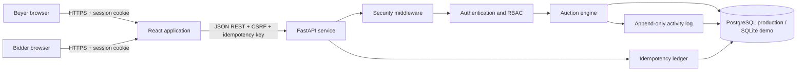
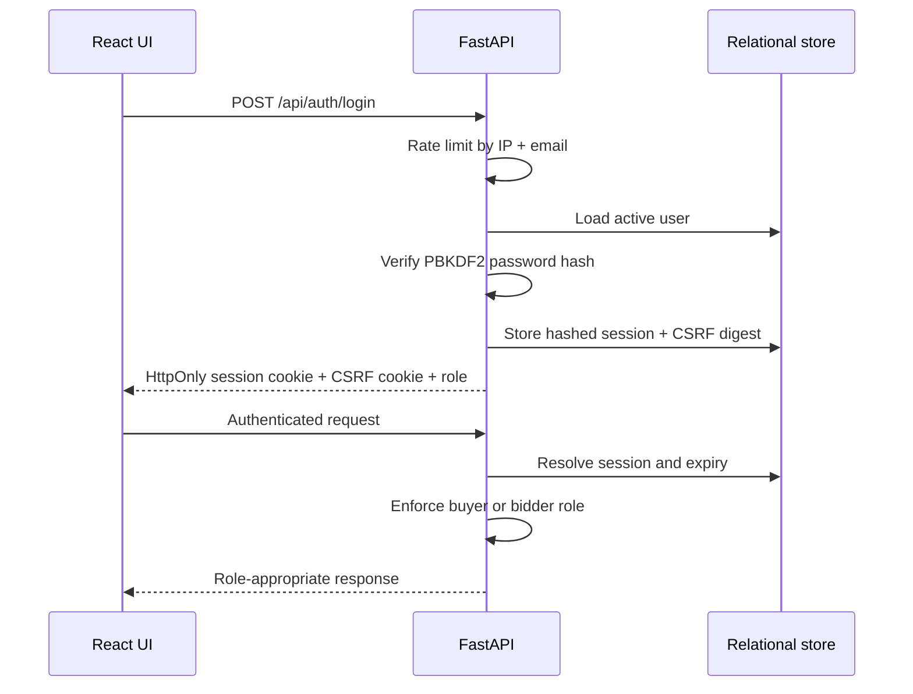
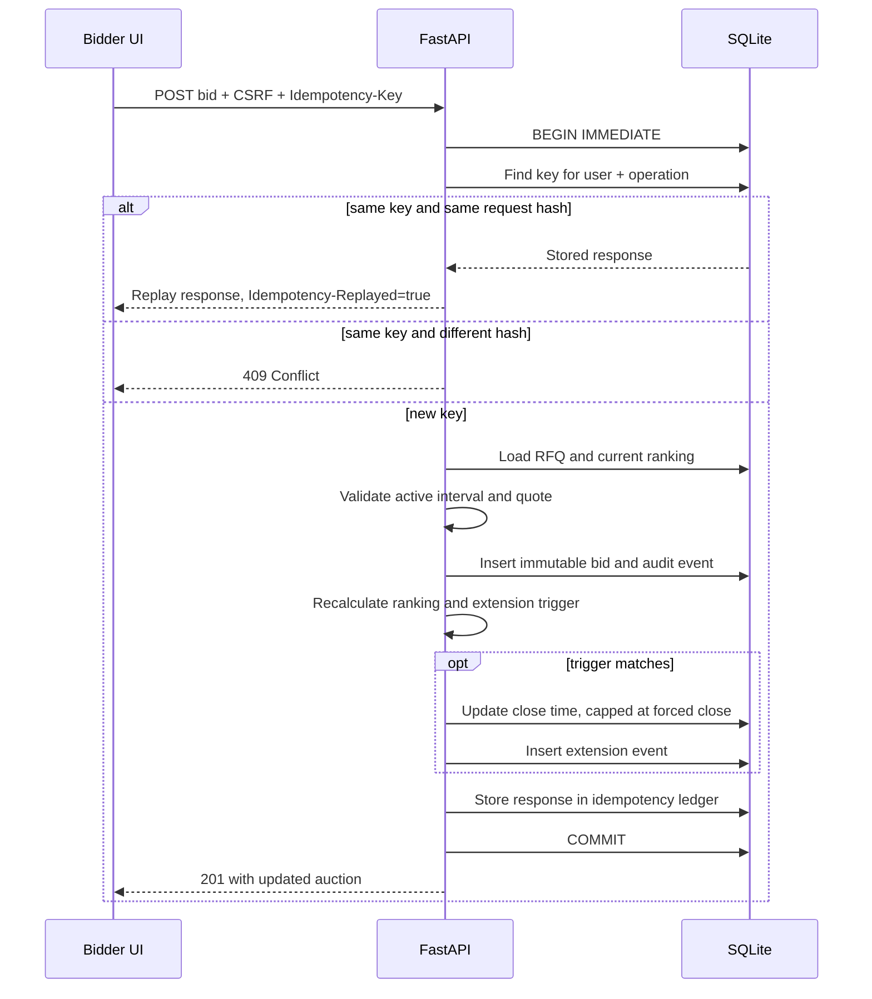

# Architecture

## Backend boundaries

- `app/api/routes` contains transport-only routers and operational endpoints.
- `app/domain` contains deterministic money, status, and extension rules without I/O.
- `app/services` coordinates transactional work and notification delivery.
- `app/repositories` requires tenant scope at the persistence boundary.
- `app/database.py` owns SQLite compatibility, bounded PostgreSQL pooling, and timeouts.
- `alembic/versions` owns ordered production schema changes.

Each write transaction contains the auction mutation, domain event, idempotency/audit state, and notification-outbox row. Delivery happens afterward and retries without repeating the auction mutation. PostgreSQL row locks serialize bids per auction; advisory locks serialize each idempotency key and schema migration.

Observability has JSON request logs with request IDs, Prometheus RED/business metrics at `/metrics`, and optional OTLP traces.

## System context

The React and FastAPI applications are built into one container and served from one origin. That keeps cookies first-party and removes the need to expose session credentials to browser JavaScript. FastAPI is the source of truth for identity, role authorization, auction status, bid totals, ranking, and extension decisions.

## Trust boundaries

1. The browser is untrusted. Supplier names, roles, timestamps, totals, and auction state are never accepted as authoritative.
2. A random session token is stored only in an HttpOnly, SameSite=Strict cookie. Only its SHA-256 digest is stored in the database.
3. State-changing requests must also supply the matching CSRF token and a valid idempotency key.
4. Buyer-only and bidder-only operations are enforced in FastAPI, not only hidden in React.
5. Every business query is scoped by the authenticated tenant. PostgreSQL transactions lock the RFQ row; SQLite demo transactions use `BEGIN IMMEDIATE`.
6. Lifecycle writes use optimistic versions and an idempotency key. SSE applies the same supplier redaction as REST.

## Login and authorization flow

## Idempotent bid flow

## Deployment

- `Dockerfile.vercel` produces the Vercel container deployment.
- `Dockerfile` and `render.yaml` support Render.
- React build assets are served by FastAPI after all API routes.
- `DATABASE_URL` activates PostgreSQL and row-level auction locking; otherwise the zero-setup SQLite demonstration mode is used.
- A production deployment still requires shared rate-limit storage and a managed identity provider.

## Observability

Every response includes `X-Request-ID` and `Server-Timing`. Structured JSON request logs include route, status, duration, and request ID. Auction mutations create business events while security-sensitive actions enter a tenant-scoped audit ledger. Operational database failures return a generic 503 with `Retry-After`; internal details and secrets are not sent to clients.
