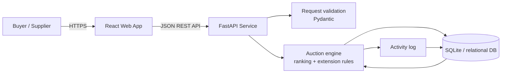
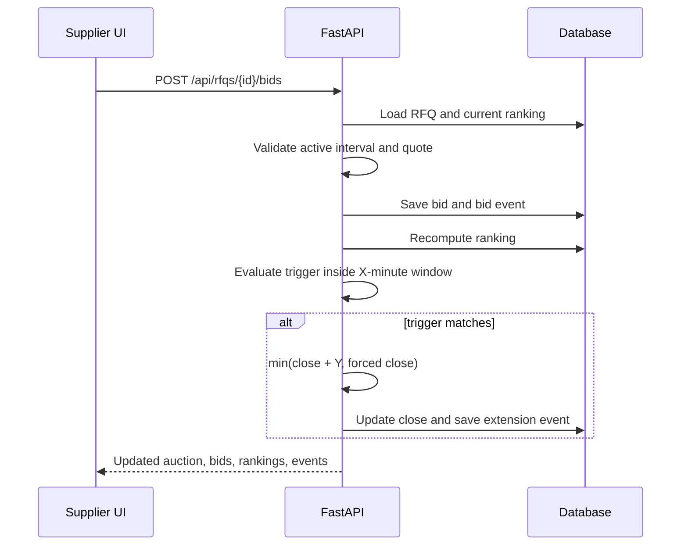

# High-Level Design

## Architecture

The React client is a procurement control tower for creating and monitoring auctions, reviewing live rankings, submitting test supplier quotes, and reading the audit trail. FastAPI is the source of truth for auction status, validation, ranking, and extension behavior. SQLite keeps the assignment runnable with no external services; the schema is portable to PostgreSQL for production.

## Request flow: bid submission

## Key design decisions

- The server accepts an optional `submitted_at` in the assignment implementation so extension rules can be tested deterministically. A production API should derive it exclusively from server time.
- `current_close_at` is stored independently from `original_close_at` to make every extension explicit and auditable.
- Status is derived from timestamps instead of persisted, preventing stale status values.
- Bid totals are calculated on the server from freight, origin, and destination charges.
- Each bid is immutable; a supplier improvement is a new bid, preserving price history.

## Production hardening

Use PostgreSQL transactions with row-level locking around bid placement, authenticated buyer/supplier roles, tenant isolation, idempotency keys, currency fields stored as integer minor units, background notifications, and WebSockets or server-sent events for instant live updates.

