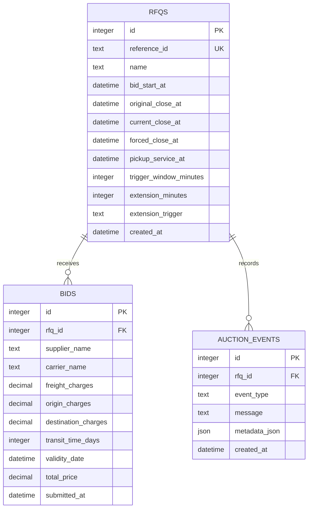

# Database Schema

## Constraints and indexes

- `reference_id` is unique.
- Forced-close ordering is validated at the API boundary; bid and extension transactions always cap the close at `forced_close_at`.
- Charges are non-negative and transit time is positive.
- `extension_trigger` is restricted to the three supported policies.
- `bids(rfq_id, total_price, submitted_at)` supports ranking.
- `auction_events(rfq_id, created_at)` supports reverse-chronological audit views.

