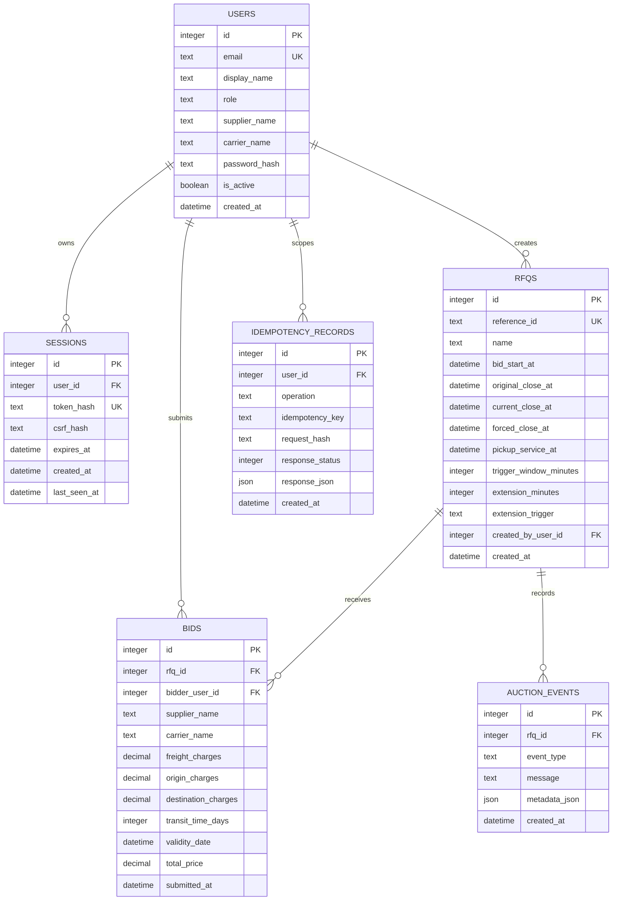

# Database Schema

## Integrity rules

- User emails and RFQ references are unique.
- Roles are constrained to `buyer` or `bidder`.
- Session and CSRF secrets are stored as one-way digests.
- Session expiry is checked on every authenticated request.
- Bid charges must be non-negative and transit time must be positive.
- Auction extension policies are constrained to the three supported trigger values.
- `(user_id, operation, idempotency_key)` is unique, preventing duplicate mutation processing.
- Foreign keys cascade session and idempotency cleanup when a user is removed.
- RFQ deletion cascades bids and auction events.

## Indexes

| Index | Purpose |
| --- | --- |
| `sessions(token_hash, expires_at)` | Fast session lookup and expiry checks |
| `bids(rfq_id, total_price, submitted_at)` | Deterministic auction ranking |
| `bids(bidder_user_id, submitted_at)` | Bidder activity lookup |
| `auction_events(rfq_id, created_at)` | Reverse chronological audit trail |
| `idempotency_records(created_at)` | 24-hour retention and cleanup operations |

## Migration behavior

`init_db()` creates all tables for a new installation and adds ownership columns to databases created by earlier versions. Demo records are inserted only when `SEED_DEMO_DATA=true` and the RFQ table is empty.
